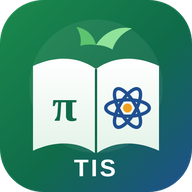
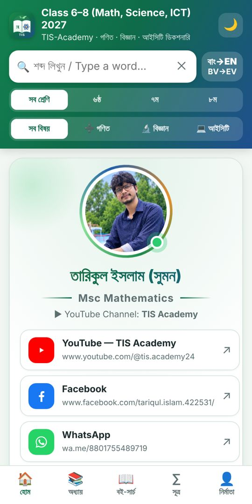
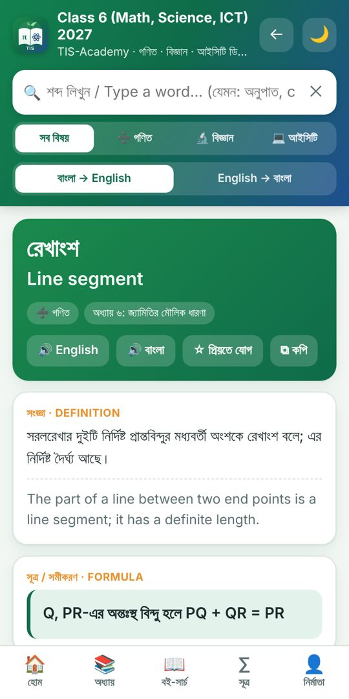
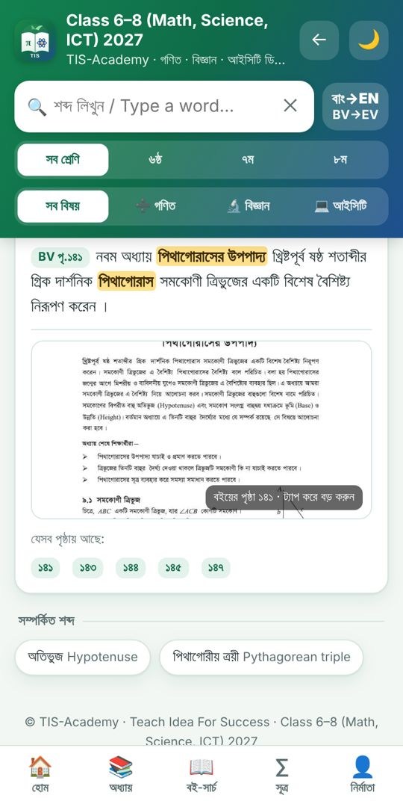
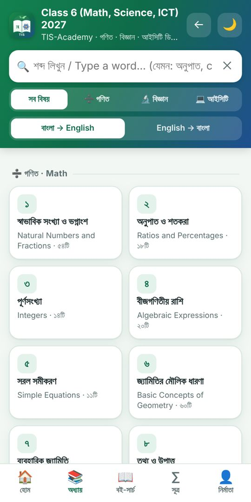
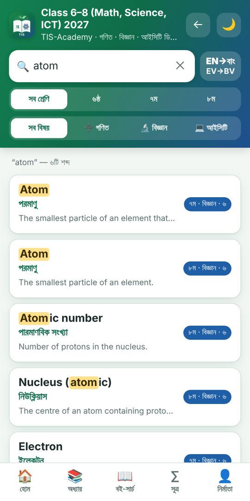
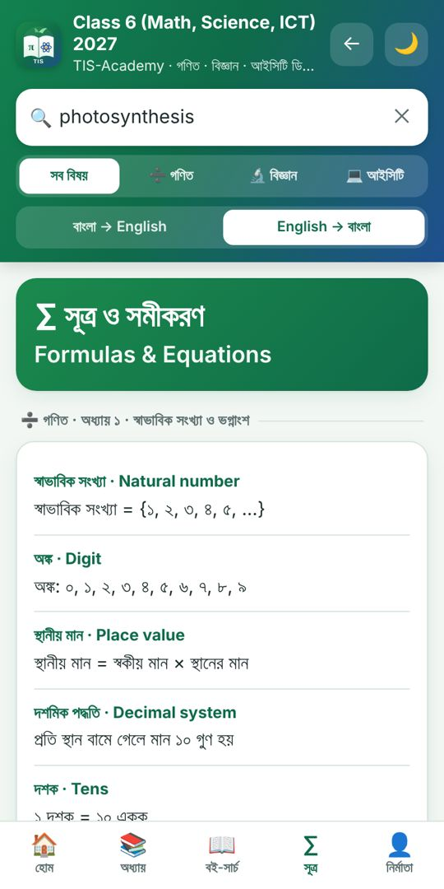

<div align="center">



# Class 6–8 (Math, Science, ICT) 2027
### ষষ্ঠ · সপ্তম · অষ্টম শ্রেণি — গণিত · বিজ্ঞান · আইসিটি দ্বিভাষিক পরিভাষা অভিধান
**TIS-Academy Bilingual Dictionary (Bangla ⇄ English) for NCTB Class 6, 7 & 8**

[](https://tariqulislam4015.github.io/TIS-Smart-Dictionary-Class-6-8/)
[](https://github.com/tariqulislam4015/TIS-Smart-Dictionary-Class-6-8/releases/latest/download/TIS-Smart-Dictionary-Class-6-8.apk)
[](https://www.youtube.com/@tis.academy24)

**🌐 Live Demo:** https://tariqulislam4015.github.io/TIS-Smart-Dictionary-Class-6-8/

</div>

---

## ✨ পরিচিতি

ষষ্ঠ, সপ্তম ও অষ্টম শ্রেণির জাতীয় পাঠ্যপুস্তক (NCTB) — **গণিত, বিজ্ঞান ও তথ্য ও যোগাযোগ প্রযুক্তি** — এর **বাংলা ভার্সন (BV)** ও **English Version (EV)** মোট **১৮টি বই** পাশাপাশি বিশ্লেষণ করে তৈরি একটি দ্বিভাষিক স্মার্ট ডিকশনারি। শিক্ষার্থী শ্রেণি ও বিষয় বেছে নিয়ে যেকোনো পরিভাষা বাংলায় বা ইংরেজিতে খুঁজলে তার অনুবাদ, সংজ্ঞা, সূত্র, চিত্র এবং **পাঠ্যবইয়ের আসল বাক্য (শব্দটি হাইলাইটসহ, পৃষ্ঠা নম্বরসহ)** দেখতে পায়। সম্পূর্ণ **অফলাইনে** চলে।

| শ্রেণি | বিষয় | পরিভাষা | অধ্যায় |
|---|---|---|---|
| ৬ষ্ঠ | ➗ গণিত | ২০১ | ৮ |
| ৬ষ্ঠ | 🔬 বিজ্ঞান | ২৩২ | ১৪ |
| ৬ষ্ঠ | 💻 আইসিটি | ৯৯ | ৫ |
| ৭ম | ➗ গণিত | ১০৩ | ১১ |
| ৭ম | 🔬 বিজ্ঞান | ১৪২ | ১৪ |
| ৭ম | 💻 আইসিটি | ৫৯ | ৫ |
| ৮ম | ➗ গণিত | ৮৮ | ১১ |
| ৮ম | 🔬 বিজ্ঞান | ১২৯ | ১৪ |
| ৮ম | 💻 আইসিটি | ৫৯ | ৫ |
| **মোট** | **৯টি বিষয়-বই** | **১১১২** | **৮৭** |

## 🚀 ফিচারসমূহ

- 🔁 **বাংলা → English (BV→EV)** ও **English → বাংলা (EV→BV)** — বাংলায় টাইপ করলে আপনাআপনি দিক বদলায়
- 📖 **বইয়ের বাক্য** — দুই বই থেকে উপযুক্ত বাক্য, খোঁজা শব্দটি **হাইলাইট** করা, পৃষ্ঠা নম্বরসহ
- 🖼️ **ছবি** — প্রতিটি শব্দের জন্য পাঠ্যবইয়ের আসল পৃষ্ঠার ছবি (জুম করা যায়) + ১১০টিরও বেশি নিজস্ব চিত্র (কোষ, চোখ, পরমাণু, বর্তনী, ভেনচিত্র, পিথাগোরাস, নেটওয়ার্ক টপোলজি …)
- ∑ **সূত্র ও সমীকরণ** — গ.সা.গু-ল.সা.গু, সূচকের নিয়ম, সালোকসংশ্লেষণ, দ্রুতি-বেগ-ত্বরণ, লিভারের নীতি, মেমোরি একক, কিবোর্ড শর্টকাট …
- 🏫 **শ্রেণি (৬ষ্ঠ / ৭ম / ৮ম) ও বিষয় বাছাই** — একই শব্দ অন্য শ্রেণিতে থাকলে “অন্য শ্রেণিতেও আছে” লিংক
- 🔍 **১৮টি বইয়ের পূর্ণ-পাঠ অনুসন্ধান** (প্রায় ৩৭,৭৫০ বাক্য)
- 🎯 কুইজ · ★ প্রিয় শব্দ · 🕘 সাম্প্রতিক খোঁজ · ✨ আজকের শব্দ · 🔊 উচ্চারণ · 🌙 ডার্ক মোড
- 📶 সম্পূর্ণ অফলাইন — ওয়েবে PWA হিসেবে, মোবাইলে Android APK হিসেবে

## 📸 স্ক্রিনশট

<p align="center">
  
</p>
<p align="center">
  
</p>

## 📱 Android APK

- **সরাসরি ডাউনলোড:** [TIS-Smart-Dictionary-Class-6-8.apk](https://github.com/tariqulislam4015/TIS-Smart-Dictionary-Class-6-8/releases/latest/download/TIS-Smart-Dictionary-Class-6-8.apk)
- `main` ব্রাঞ্চে প্রতিবার push করলে **GitHub Actions** নিজে থেকেই নতুন APK বানিয়ে [Releases](https://github.com/tariqulislam4015/TIS-Smart-Dictionary-Class-6-8/releases)-এ আপলোড করে।
- নিজে বানাতে চাইলে: Android Studio → **File → Open → `android/`** → **Build → Build APK(s)**।
  APK-এর ভেতরের অ্যাপটি সরাসরি `docs/` ফোল্ডার থেকে নেওয়া হয়, তাই ওয়েব ও মোবাইল সংস্করণ সবসময় একই থাকে।

## 🗂️ প্রজেক্ট কাঠামো

```
TIS-Smart-Dictionary-Class-6-8/
├── docs/                  ← ওয়েব অ্যাপ (GitHub Pages Live Demo + APK-এর ভেতরের অ্যাপ)
│   ├── index.html         ← সম্পূর্ণ অ্যাপ (HTML + CSS + JS)
│   ├── data_6m.js … data_8i.js ← প্রতিটি শ্রেণি-বিষয়ের পরিভাষা, অধ্যায় ও বইয়ের বাক্য
│   ├── svg_m.js / svg_s.js / svg_i.js  ← গণিত / বিজ্ঞান / আইসিটি চিত্র
│   ├── img/               ← পাঠ্যবইয়ের পৃষ্ঠার ছবি
│   ├── sw.js, manifest.webmanifest     ← অফলাইন PWA
│   └── me.jpg, icon.svg
├── android/               ← Android (WebView) প্রজেক্ট
├── screenshots/
└── .github/workflows/
    ├── pages.yml          ← Live Demo স্বয়ংক্রিয় ডিপ্লয় (gh-pages ব্রাঞ্চ)
    └── build-apk.yml      ← APK স্বয়ংক্রিয় বিল্ড ও Release
```

## 💻 লোকালি চালানো

```bash
git clone https://github.com/tariqulislam4015/TIS-Smart-Dictionary-Class-6-8.git
cd TIS-Smart-Dictionary-Class-6-8/docs
python3 -m http.server 8000   # তারপর ব্রাউজারে http://localhost:8000
```
অথবা শুধু `docs/index.html` ফাইলটি ব্রাউজারে খুলুন।

## 👨‍🏫 নির্মাতা

<div align="center">


### তারিকুল ইসলাম (সুমন)
**——— Msc Mathematics ———**
**TIS-Academy · Teach Idea For Success**

[](https://www.youtube.com/@tis.academy24)
[](https://www.facebook.com/tariqul.islam.422531/)
[](https://wa.me/8801755489719)
[](https://www.linkedin.com/in/tariqul3315/)
[](https://github.com/tariqulislam4015)
</div>

## 📚 কৃতজ্ঞতা ও নোট

- পরিভাষা ও বাক্যের উৎস: জাতীয় শিক্ষাক্রম ও পাঠ্যপুস্তক বোর্ড (NCTB), ষষ্ঠ, সপ্তম ও অষ্টম শ্রেণির গণিত, বিজ্ঞান ও তথ্য ও যোগাযোগ প্রযুক্তি পাঠ্যবই (বাংলা ভার্সন ও English Version)।
- কিছু পরিভাষা পাঠ্যবইয়ে সরাসরি নেই; অ্যাপে সেগুলো “সহায়ক শব্দ” হিসেবে চিহ্নিত।
- বাংলা বইয়ের লেখা স্ক্যান (OCR) থেকে নেওয়া, তাই কিছু বাক্যে ছোটখাটো বানান ভুল থাকতে পারে — ভুল চোখে পড়লে [Issue](https://github.com/tariqulislam4015/TIS-Smart-Dictionary-Class-6-8/issues) খুলে জানান।
- `android/tis-debug.keystore` শুধু ফ্রি বিতরণের APK সাইন করার জন্য; Play Store-এ দিতে চাইলে নিজের গোপন keystore ব্যবহার করুন।

<div align="center">

© 2026 TIS-Academy · Made with ❤️ for the students of Bangladesh

</div>
